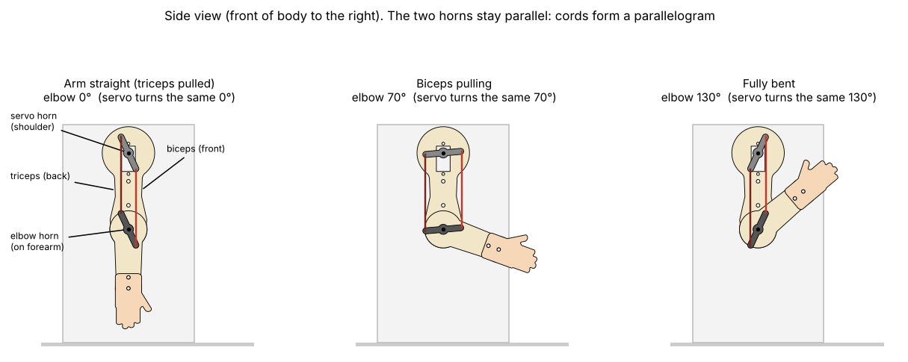
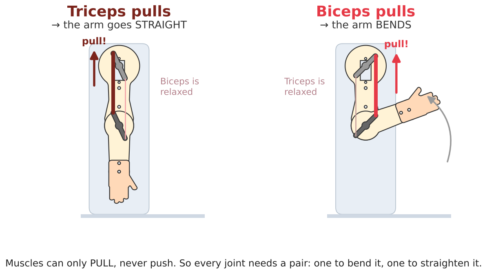
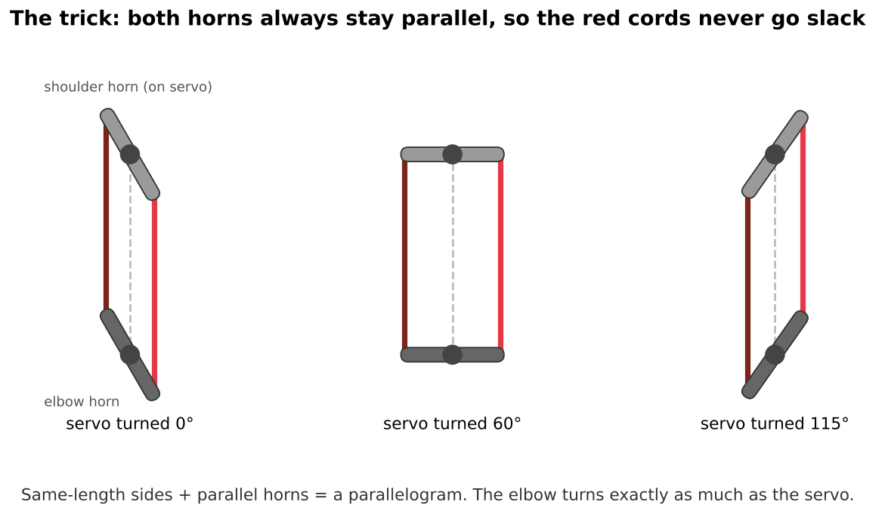
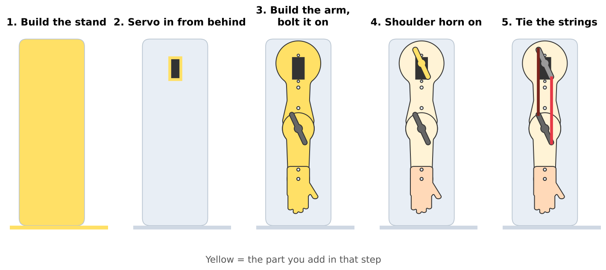
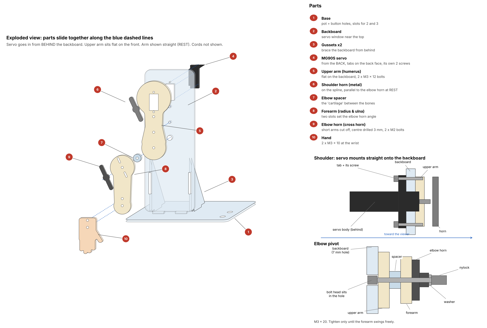

# Motorised Elbow Model (Muscles & Joints)

A laser-cut, servo-driven model of the human elbow that shows how the **biceps** and **triceps** work as an antagonistic pair. It was designed for a school science project and needs one small piece of 3 mm acrylic, an MG90S servo, an ESP8266 board, a knob and a button.

**Author:** Sandheep Rajendran



## What it shows



- **Hinge joint:** the elbow bends in one plane only.
- **Antagonistic pair:** muscles can only pull. The biceps cord bends the elbow and the triceps cord straightens it.
- **Origin and insertion:** each "muscle" runs from the shoulder to the forearm near the elbow. The back tip of the elbow horn sits where the olecranon is, the triceps' real attachment point.
- **Third-class lever:** the cords pull 7–17 mm from the elbow, but the hand is about 90 mm away, so a short pull makes a large, fast movement.

## How it works



A horn on the servo at the shoulder and a second horn bolted to the forearm at the elbow are tied tip to tip by two cords. Both cords use holes the same distance from each hub (16.8 mm). The two horns, the two cords and the upper arm form a **parallelogram**, so the horns always stay parallel. The elbow turns exactly as far as the servo (1:1, 0–130°), and both cords stay exactly 70 mm long through the whole movement.

The ESP8266 reads a knob and moves the arm to match. A button starts slow "biceps curls". The board also makes its own Wi-Fi hotspot, so a phone can drive the arm with a slider.

## Specifications

| Item | Value |
|---|---|
| Height | 200 mm |
| Base | 145 × 90 mm |
| Upper arm / forearm | 70 mm / 54 mm (pivot to pivot) |
| Elbow travel | 0–130°, 1:1 with servo |
| Servo | MG90S (metal gear), driven directly; no servo driver board needed |
| Controller | ESP8266 (NodeMCU or Wemos D1 mini) |
| Material | One 171 × 285 mm piece of 3 mm acrylic, cut only |

## What's in the repo

| Folder | Contents |
|---|---|
| [`cad/`](cad) | Laser cut files (`.dxf`, `.svg`), 1:1 mm, all parts nested on 171 × 285 mm |
| [`drawings/`](drawings) | Engineering drawings DWG-01 to DWG-04 (PNG + one PDF) and the exploded assembly diagram |
| [`firmware/`](firmware/elbow_arm_esp8266) | ESP8266 sketch: knob control, demo mode, phone control over Wi-Fi |
| [`docs/BUILD_GUIDE.md`](docs/BUILD_GUIDE.md) | Full guide: parts list, assembly, wiring, calibration, tips, troubleshooting |
| [`generator/`](generator) | Python scripts that generate every part, the nesting, the drawings and the diagrams from parameters |
| [`images/`](images) | Illustrations (muscles, lever, parallelogram, build steps), motion preview and cut layout |

## Quick start

1. Laser cut [`cad/arm_model_cut_3mm_acrylic.dxf`](cad/arm_model_cut_3mm_acrylic.dxf) from 3 mm acrylic.
2. Get the parts in the [parts list](docs/BUILD_GUIDE.md#3-components-and-parts-list).
3. Assemble following [section 5 of the guide](docs/BUILD_GUIDE.md#5-assembly) and the [assembly diagram](drawings/assembly_diagram.png).
4. Wire it as in [DWG-04](drawings/DWG-04_wiring.png) and upload [`elbow_arm_esp8266.ino`](firmware/elbow_arm_esp8266/elbow_arm_esp8266.ino).
5. Calibrate `REST_DEG` so the two horns are parallel, then tie the cords.





## Regenerating the design

The whole design is parametric: arm lengths, horn radius, servo size and sheet thickness are set at the top of `generator/make_arm.py`. After changing them:

```bash
cd generator
pip install -r requirements.txt
python3 nest.py        # optional: re-nest the parts (a few minutes); writes out/nest_best.json
python3 make_arm.py    # cut files -> out/arm_model_cut_3mm_acrylic.dxf / .svg
python3 render.py      # motion preview and cut-sheet preview
python3 assembly.py    # exploded assembly diagram
python3 drawings.py    # engineering drawings DWG-01..04 and engineering_drawings.pdf
python3 illustrations.py  # kid-friendly illustrations (muscle pair, lever, parallelogram, build steps)
```

## Licence

- Code (`firmware/`, `generator/`): [MIT](LICENSE)
- Drawings, CAD files, images and documentation: [CC BY 4.0](LICENSE-CC-BY-4.0.md)

You're free to build, modify and share this model, including commercially, as long as you credit **Sandheep Rajendran**.
