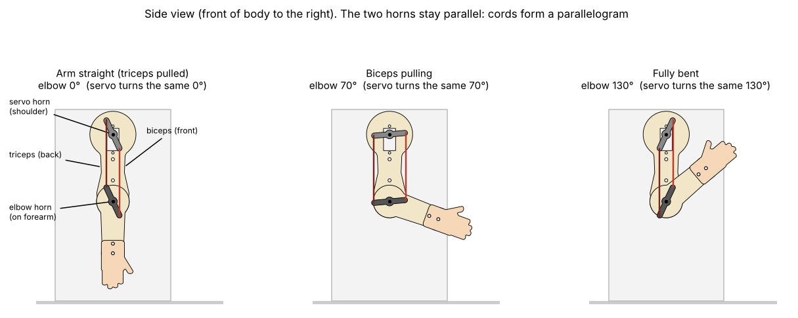
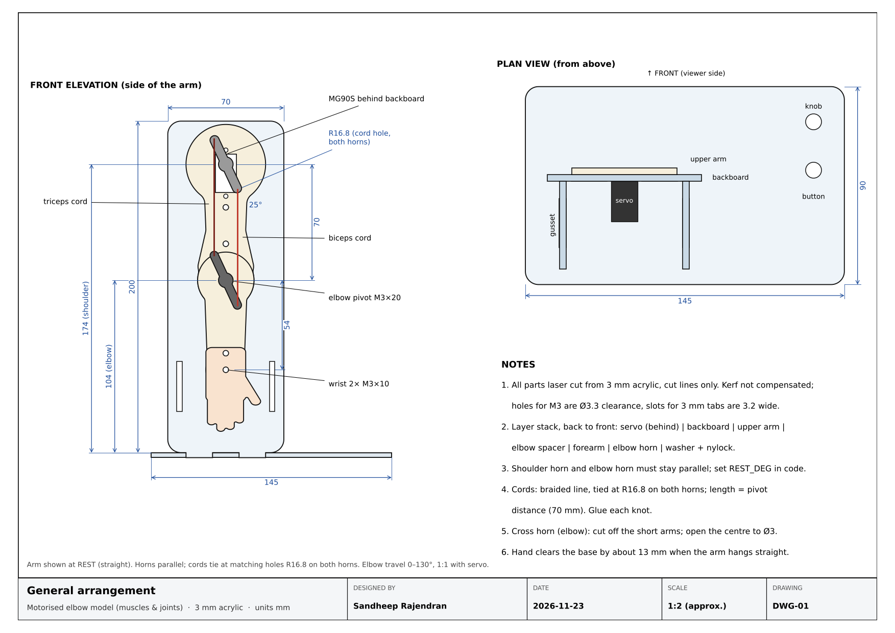
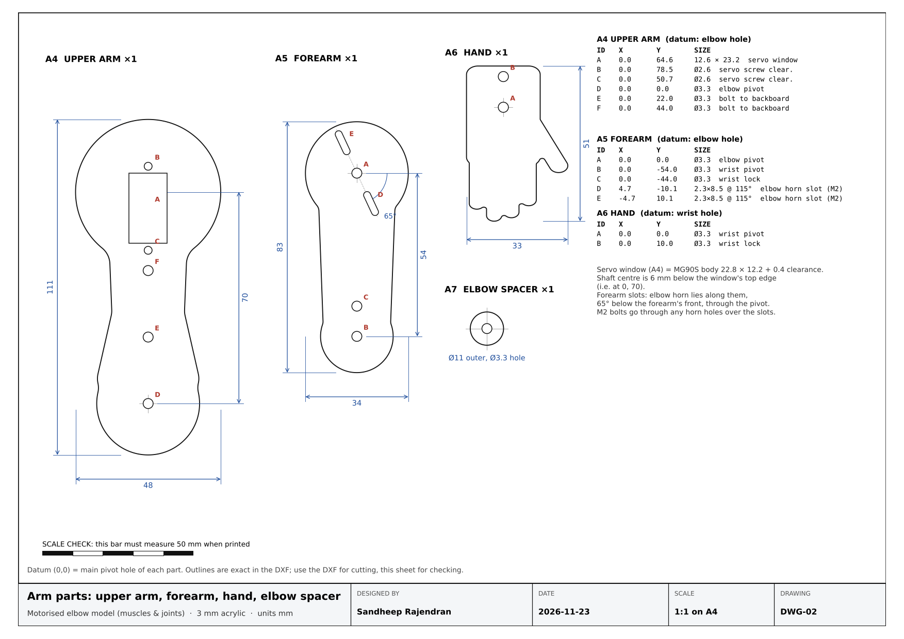
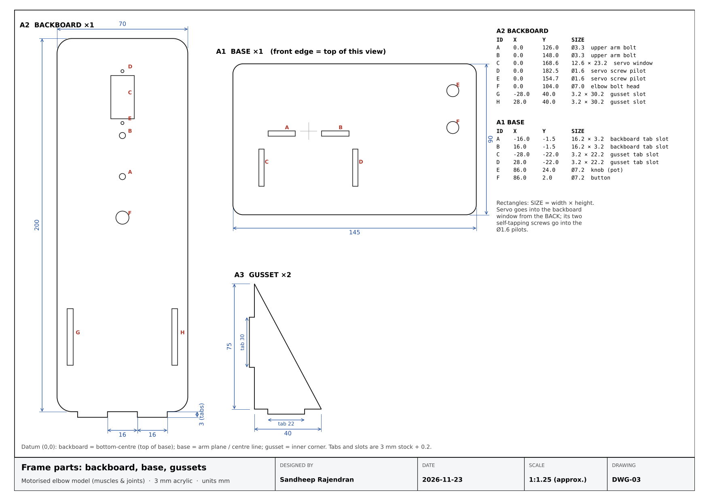
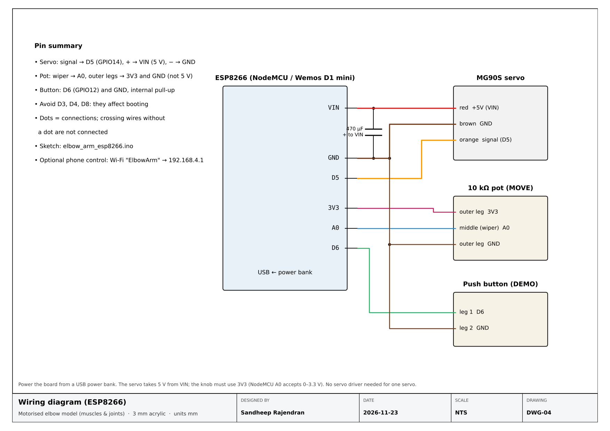
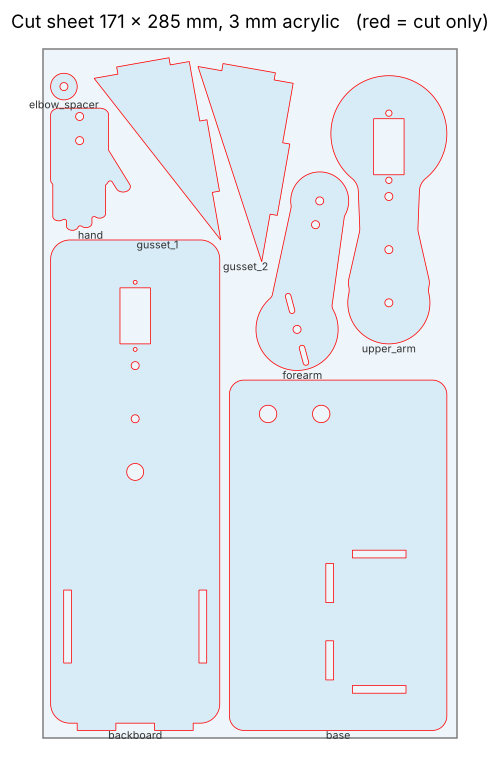
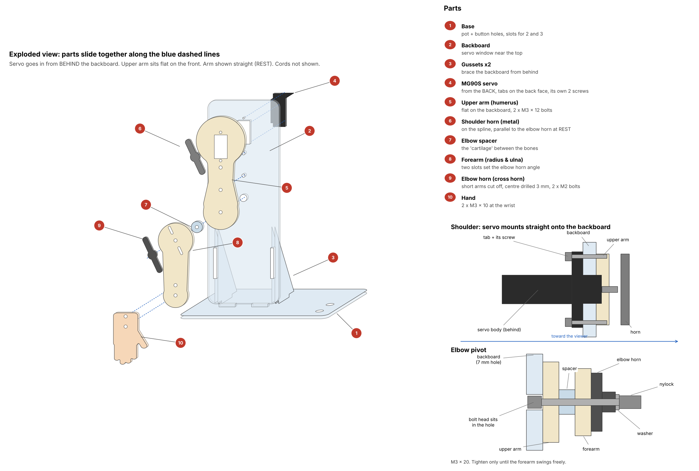

# Motorised Elbow Model: Complete Guide & Engineering Drawings

**Author:** Sandheep Rajendran · Open-source design (code MIT, drawings and docs CC BY 4.0)

## 1. Overview

A working model of the human elbow for a school project on muscles and joints. It is a right arm seen from the side, cut from 3 mm acrylic. An MG90S servo at the shoulder pulls two cords, the **biceps** in front and the **triceps** behind, so the forearm bends and straightens like a real arm. A knob moves the arm, a button runs slow "biceps curls" on their own, and a phone can move it over Wi-Fi.

What it teaches:

- The elbow is a **hinge joint**: it bends in one plane only.
- Muscles work in **antagonistic pairs**: they can only pull, so one bends the joint and the other straightens it.
- Muscles attach near the joint, which makes the forearm a **third-class lever**: a short pull gives a large, fast movement of the hand.

**Key specifications**

| Item | Value |
| --- | --- |
| Overall height | 200 mm (backboard) |
| Base footprint | 145 × 90 mm |
| Upper arm (shoulder to elbow pivot) | 70 mm |
| Forearm (elbow to wrist pivot) | 54 mm |
| Shoulder / elbow pivot height above base | 174 mm / 104 mm |
| Elbow movement | 0° (straight) to 130° (fully bent) |
| Servo to elbow ratio | 1 : 1 |
| Cord attachment radius (both horns) | 16.8 mm |
| Cord length (biceps and triceps) | 70 mm, stays constant through the whole movement |
| Servo | MG90S metal gear, 5 V, about 1.8 kg·cm. The arm needs well under 0.5 kg·cm |
| Controller | ESP8266 (NodeMCU or Wemos D1 mini), USB powered. No servo driver needed |
| Material | One 171 × 285 mm piece of 3 mm acrylic, cut only (no engraving) |

## 2. How it works

**The muscles.** Two horns (lever arms) do the work. One is on the servo at the shoulder, and one is bolted to the forearm at the elbow. The biceps cord ties the front tips of the two horns together, and the triceps cord ties the back tips together. When the servo turns one way, it pulls the biceps cord up, which pulls the front of the forearm up, so the elbow bends. Turning back pulls the triceps cord, which straightens the arm. Neither cord can push, which is exactly why real joints need a pair of muscles.

**Why the cords never go slack.** The two horns use holes at the same distance from their centres (16.8 mm). The horns, plus the two cords and the upper arm between the pivots, form a **parallelogram**. In a parallelogram, opposite sides stay parallel and the same length however it leans. So both horns always point the same way, the elbow turns exactly as far as the servo (1:1), and both cords stay exactly 70 mm long the whole time. If the holes don't match, the parallelogram breaks: one hole's difference (about 2.6 mm) lets a cord go nearly 5 mm slack at one end of the movement.

**Where the muscles attach.** Each cord starts at the shoulder (the muscle's **origin**) and ends on the forearm near the elbow (its **insertion**). The back tip of the elbow horn sticks up behind the elbow, just like the olecranon of the ulna, the bony point where the real triceps attaches.

**The lever.** The cords pull between 7 and 17 mm from the elbow pivot, but the hand is about 90 mm away. A 30 mm pull on the biceps sweeps the hand through a large arc. That makes the arm fast and far-reaching, but the muscle has to pull several times harder than the weight in the hand. The horn has its best grip when the forearm is near horizontal, which is the same position where a real arm works hardest to hold a load.

**The control.** The ESP8266 plays the role of the brain and nerves. It reads the knob (potentiometer) and moves the servo to match, easing in and out so the motion looks natural. Press the button and it runs slow curls on its own, printing which muscle is contracting to the Serial Monitor. It also makes its own Wi-Fi hotspot, so a phone can move the arm with an on-screen slider.

## 3. Components and parts list

**Laser-cut acrylic (3 mm, one 171 × 285 mm piece)**

| # | Part | Qty | Size (mm) | Job |
| --- | --- | --- | --- | --- |
| A1 | Base | 1 | 145 × 90 | Holds the frame; holes for knob and button |
| A2 | Backboard | 1 | 70 × 203 (incl. tabs) | The "torso"; servo window near the top |
| A3 | Gusset | 2 | 43 × 78 | Triangle braces behind the backboard |
| A4 | Upper arm (humerus) | 1 | 48 × 111 | Sits flat on the backboard |
| A5 | Forearm (radius and ulna) | 1 | 34 × 83 | Two slots set the elbow horn angle |
| A6 | Hand | 1 | 33 × 51 | Bolted at the wrist |
| A7 | Elbow spacer | 1 | Ø 11 | Gap between the bones (the "cartilage") |

**Fasteners**

| Where | Part | Qty |
| --- | --- | --- |
| Elbow pivot | M3 × 20 bolt + M3 nylock nut + M3 washer | 1 |
| Upper arm to backboard | M3 × 12 bolt + M3 nut | 2 |
| Wrist | M3 × 10 bolt + M3 nylock nut | 2 |
| Elbow horn to forearm | M2 × 10 bolt + M2 nut | 2 |
| Servo to backboard | the 2 self-tapping screws that come with the MG90S | 2 |
| Feet | stick-on rubber bumpers | 4 |

**Electronics**

| Part | Qty | Notes |
| --- | --- | --- |
| MG90S servo (metal gear) | 1 | With its horns: the metal double-arm horn goes on the servo; the plastic cross horn goes at the elbow |
| ESP8266 board (NodeMCU v2/v3 or Wemos D1 mini) | 1 | Plus micro-USB cable. Drives the one servo directly, so no servo driver board is needed |
| 10 kΩ potentiometer + knob | 1 | Panel mount, 7 mm bush |
| Mini push button, momentary (PBS-110 type) | 1 | Panel mount, 7 mm hole |
| 470 µF electrolytic capacitor, 10 V or more | 1 | Recommended; steadies the servo supply |
| Jumper wires (Dupont) | ~10 | Female-to-female for the board's header pins |
| USB power bank | 1 | Better than a laptop port |

**Consumables**

- Braided fishing line, 20–30 lb: about 40 cm. Braid doesn't stretch; nylon monofilament does.
- Fevikwik or acrylic cement for the tab joints, and a drop for each knot.

**Tools**

- Small screwdrivers, pliers or a 5.5 mm spanner for M3 nuts
- Side cutters (to trim the cross horn's short arms)
- Hand drill with a 3 mm bit (to open up the cross horn's centre)
- Ruler or calipers (to match the horn holes)
- Soldering iron, optional (for neat wires to the knob and button)

## 4. Engineering drawings

Four A4 drawing sheets, plus the cut layout. All dimensions are in millimetres. The DXF and SVG files are the master for cutting; these sheets are for checking parts and understanding the design. The full set is also in [`engineering_drawings.pdf`](../drawings/engineering_drawings.pdf).

| Sheet | Title | Scale | What it shows |
| --- | --- | --- | --- |
| DWG-01 | General arrangement | about 1:2 | Front elevation with key heights and lengths; plan view of the base; build notes |
| DWG-02 | Arm parts | 1:1 on A4 | Upper arm, forearm, hand and spacer, with hole tables. Includes a 50 mm scale-check bar |
| DWG-03 | Frame parts | about 1:1.25 | Backboard, base and gusset, with hole and slot tables |
| DWG-04 | Wiring diagram | not to scale | ESP8266, servo, knob, button and capacitor connections |

**How to read the hole tables.** Each hole or slot has a red letter on the drawing. The table gives its X and Y position from the part's datum (marked on each sheet: usually the main pivot hole), its size and what it is for. Rectangles are listed as width × height.

**Design rules used throughout:**

- M3 holes are Ø 3.3 (clearance). M2 slots are 2.3 wide.
- Slots for 3 mm tabs are 3.2 wide, so tabs push in snugly and are then glued.
- The servo window is the MG90S body (22.8 × 12.2 mm) plus 0.4 mm clearance.
- The laser's kerf (about 0.1–0.2 mm) is not compensated; the clearances above allow for it.

**DWG-01 General arrangement:** the assembled model, key heights and the base layout.

**DWG-02 Arm parts:** print at 100% on A4 and check the 50 mm bar to compare parts 1:1.

**DWG-03 Frame parts:** backboard, base and gussets.

**DWG-04 Wiring diagram (ESP8266):**

**Cut layout:** all eight parts nested on one 171 × 285 mm piece, at least 3 mm apart.

## 5. Assembly

The exploded diagram shows where every part goes. Its two section drawings show the layer order at the shoulder and at the elbow.

**Layer stack (back to front)**

- **Shoulder:** servo (from behind, tabs on the back face of the backboard) → backboard → upper arm → shoulder horn.
- **Elbow:** bolt head (sitting in the Ø 7 hole in the backboard) → upper arm → spacer → forearm → elbow horn (hub facing you) → washer → nylock nut.

**Steps**

1. **Peel and dry-fit the frame.** Peel off the protective film. Push the backboard's two bottom tabs and both gussets' bottom tabs into the base slots, and the gussets' front tabs into the backboard slots. When everything sits square, glue the joints with Fevikwik or acrylic cement.
2. **Fit the servo.** Push the MG90S into the backboard's window from the back, shaft at the top end of the window and pointing to the front. The mounting tabs rest on the back face. Fix it with its two screws, which self-tap into the Ø 1.6 pilot holes.
3. **Prepare the elbow horn.** Snip the plastic cross horn's two short arms off flush with the hub. Drill the centre out to 3 mm. Measure the shoulder horn's outermost hole from its centre (about 16.8 mm) and mark the elbow-horn hole at the same distance.
4. **Fit the elbow horn.** Lay it on the front of the forearm with the hub over the elbow hole and the long arm along the two slots. Bolt it down with 2 × M2 × 10 through whichever horn holes sit over the slots: heads behind the forearm, nuts on top.
5. **Attach the hand.** Bolt it to the front of the forearm's wrist end with 2 × M3 × 10 and nylock nuts. Take the top bolt out later if you want to show the wrist as a second hinge.
6. **Make the elbow.** Push the M3 × 20 from behind through the upper arm, spacer, forearm and elbow horn hub. Add the washer and nylock nut. Tighten until the forearm swings freely without wobbling.
7. **Mount the arm.** Lay the upper arm flat on the front of the backboard. The top of the servo pokes into the upper arm's window and the elbow bolt head drops into the Ø 7 hole. Fix it with 2 × M3 × 12 bolts from the front, nuts on the back.
8. **Wire and program.** Wire the ESP8266 as in DWG-04, mount the knob and button in the base and upload the sketch (section 6). On power-up the servo goes to its REST position.
9. **Fit the shoulder horn.** With the servo powered at REST and the arm hanging straight, press the metal horn onto the spline parallel to the elbow horn: front end pointing down and forward, about 25° off vertical. Fix it with the horn screw. If the spline teeth stop it lining up exactly, adjust `REST_DEG` in the sketch a few degrees until the two horns are exactly parallel.
10. **Tie the muscles.** Keep the servo powered at REST and the arm hanging straight.
    - **Biceps:** front tip of the shoulder horn to the front tip of the elbow horn.
    - **Triceps:** back tip to back tip.
    - Use the matching holes (R 16.8 on both horns). Each cord should be just snug, the same length as the gap between the pivots (70 mm). Knot on top of the horn and put a drop of glue on each knot.

**Exploded assembly diagram:**

## 6. Electronics and code

**Wiring** (see DWG-04)

| From | To (NodeMCU label) |
| --- | --- |
| Servo orange (signal) | D5 (GPIO14) |
| Servo red (+) | VIN (5 V from USB) |
| Servo brown (−) | GND |
| Pot middle leg (wiper) | A0 |
| Pot outer legs | 3V3 and GND. Not 5 V: the NodeMCU's A0 takes 0–3.3 V. Swap them if the knob works backwards |
| Button | D6 (GPIO12) and GND (no resistor; the sketch uses the internal pull-up) |
| 470 µF capacitor (recommended) | Across VIN and GND near the servo, + leg to VIN |

Power the board from a USB power bank. Laptop ports often can't supply the servo's starting current, which makes the board reset. Avoid D3, D4 and D8 for anything else you add: they affect how the ESP8266 boots.

**Do you need a servo driver?** No. The ESP8266 drives one MG90S directly; its 3.3 V signal works with the servo, and the servo's power comes from VIN, not the ESP8266's own 3.3 V regulator. A PCA9685 driver board only makes sense if you later add several servos (a moving wrist or fingers, for example).

**The sketch** ([`elbow_arm_esp8266.ino`](../firmware/elbow_arm_esp8266/elbow_arm_esp8266.ino)). In the Arduino IDE, add the ESP8266 board package (Boards Manager URL `https://arduino.esp8266.com/stable/package_esp8266com_index.json`), then pick **NodeMCU 1.0 (ESP-12E Module)** or **LOLIN(WEMOS) D1 mini**. The Servo and Wi-Fi libraries come with the board package.

| Setting | Default | What it does |
| --- | --- | --- |
| `REST_DEG` | 25 | Servo angle with the arm hanging straight. Fine-tune so the two horns are parallel |
| `RANGE_DEG` | 130 | Servo travel from straight to fully bent. 1:1, so this is also the elbow travel. Keep it at 150 or below |
| `REVERSE` | false | Set to true if the arm bends when it should straighten |
| `PULSE_MIN_US` / `PULSE_MAX_US` | 500 / 2400 | MG90S pulse range. Set explicitly because the ESP8266 core's default (1000–2000 µs) gives only about 90° of travel |
| `WIFI_ON`, `AP_SSID`, `AP_PASS` | true, ElbowArm, elbow123 | The phone hotspot. Set `WIFI_ON` to false to turn it off |

**Modes**

- **MOVE (knob):** the arm follows the knob, smoothed so it moves like a muscle rather than jerking.
- **DEMO (button):** slow biceps curls with ease-in and ease-out. The Serial Monitor (115200 baud) prints which muscle is contracting. Press again to stop.
- **Phone:** join the Wi-Fi network **ElbowArm** (password `elbow123`) and open `http://192.168.4.1`. The page has a slider and a demo button. Turning the knob takes control back.

**Calibration, in order**

1. Upload the sketch with the horn off. The servo goes to `REST_DEG`.
2. Fit the shoulder horn parallel to the elbow horn (arm hanging straight). Adjust `REST_DEG` until it's exact.
3. Tie the cords at REST.
4. Turn the knob slowly to full. If the servo buzzes or strains at the bent end, lower `RANGE_DEG` by 5–10.

## 7. Tips

**Laser cutting**

- Send the DXF (layer CUT) or the SVG; both are 1:1 in mm. Ask the shop to cut from an offcut about 175 × 290 mm, which is often cheaper than starting a new sheet.
- Ask them to measure the sheet. "3 mm" acrylic is often 2.7–2.9 mm; thinner sheet makes the tab slots loose, but glue still fixes it.
- Keep the protective film on until assembly so the parts don't scratch.
- Check one M3 bolt in a Ø 3.3 hole and one tab in a slot before you leave the shop.

**Mechanical**

- Matching holes on the two horns matter more than anything else. Measure both from the centre of the hub, not from the edge.
- Do not overtighten the elbow nylock. The forearm should drop under its own weight when the servo is unpowered.
- Acrylic cracks if bolts are forced. Open any tight hole with a 3.5 mm drill by hand rather than forcing the bolt.
- Glue the frame tabs only after the dry fit is square; Fevikwik sets in seconds.

**Cords**

- Use braided fishing line; monofilament stretches and the arm will feel sloppy.
- A double overhand knot plus a drop of glue is enough. Leave a 5 mm tail.
- Tie both cords with the servo powered at REST, so the horn can't move while you tie.

**Electronics**

- Calibrate before tying the cords; a wrong `REST_DEG` with cords tied can strain the servo.
- If the servo jitters, it's almost always the power supply: use a power bank and add the capacitor.
- Don't run the servo against a stop. If you hear it buzzing at either end, reduce `RANGE_DEG`.

**Presentation**

- Add printed labels: humerus, radius, ulna, biceps, triceps, tendon, elbow (hinge joint).
- Use DEMO mode, or the phone slider, while presenting so both hands are free to point.
- Show the lever: bend the arm slowly and point out how a small pull near the elbow makes the hand move a long way.
- Unplug the servo and move the arm by hand to show that each muscle can only pull, never push.
- Remove the top wrist bolt to show a second hinge joint.

## 8. Troubleshooting

| Problem | Likely cause | Fix |
| --- | --- | --- |
| One cord goes slack partway through the movement | Horns not parallel, or tie holes at different distances from the centre | Adjust `REST_DEG`; re-tie at matching holes |
| Arm bends when it should straighten | Servo turns the other way | Set `REVERSE = true` |
| Knob works backwards | Pot outer legs swapped | Swap the 3V3 and GND legs, or set `REVERSE` |
| Board resets or servo jitters | Weak USB supply | Use a power bank; add the 470 µF capacitor |
| Servo only moves about 90° | Default ESP8266 pulse range | Keep `PULSE_MIN_US` 500 and `PULSE_MAX_US` 2400 in `servo.attach` |
| Servo buzzes at full bend | Asking for more travel than the arm allows | Lower `RANGE_DEG` by 5–10 |
| Phone can't find ElbowArm | Wi-Fi off or board still booting | Check `WIFI_ON = true`; wait a few seconds after power-up |
| Elbow stiff or sticky | Nylock too tight | Back it off a quarter turn |
| Elbow wobbles | Nylock too loose | Tighten until the wobble just stops |
| Shoulder horn rubs the upper servo screw | Tall screw head | Use a lower-profile head, or put a thin washer under the horn |
| Tabs loose in slots | Thin sheet | Glue the joints |

## 9. Files

| File | What it is |
| --- | --- |
| [`cad/arm_model_cut_3mm_acrylic.dxf`](../cad/arm_model_cut_3mm_acrylic.dxf) / [`.svg`](../cad/arm_model_cut_3mm_acrylic.svg) | Laser cut files, 1:1 mm, cut lines only, all parts nested on 171 × 285 mm |
| [`drawings/engineering_drawings.pdf`](../drawings/engineering_drawings.pdf) | DWG-01 to DWG-04 as one A4 PDF |
| [`drawings/assembly_diagram.png`](../drawings/assembly_diagram.png) / `.pdf` | Exploded view, parts list and layer sections |
| [`firmware/elbow_arm_esp8266/elbow_arm_esp8266.ino`](../firmware/elbow_arm_esp8266/elbow_arm_esp8266.ino) | ESP8266 sketch: knob, demo button and phone control |
| [`generator/`](../generator) | Python scripts that regenerate the parts, nesting, drawings and diagrams from parameters |

Design and documentation by Sandheep Rajendran. Code under the MIT licence; drawings and documentation under CC BY 4.0. You're free to build, change and share the model; please credit the author.
